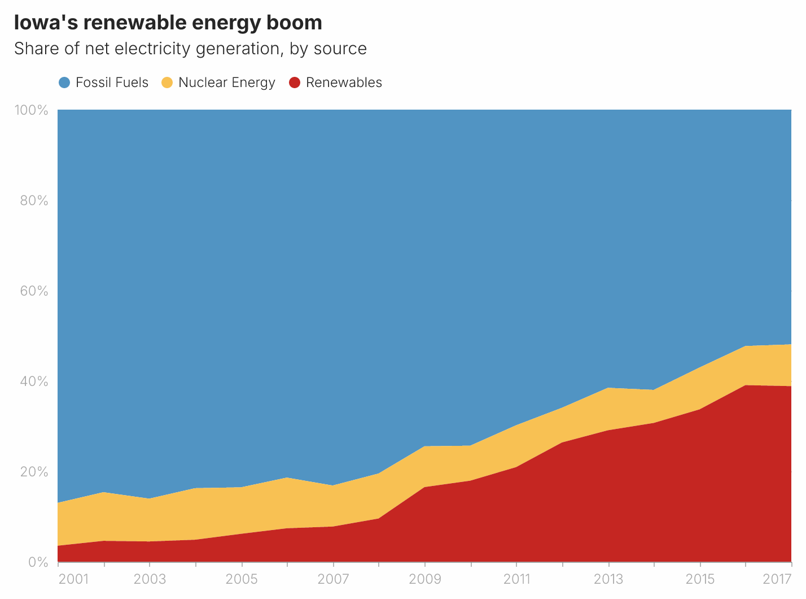

# altair-stiles

My chart theme for [Altair](https://altair-viz.github.io/), the Python charting library.



More charts, with code, are in [examples](examples/).

## Install

```bash
uv add altair-stiles
```

or `pip install altair-stiles`. It needs Python 3.10+ and Altair 5.5+.

## Use

```python
import altair as alt

alt.theme.enable("stiles")
```

Every chart made after that line uses the theme. Altair finds the theme by name once the package is installed, so there is nothing else to import.

The colors are available if you need one directly:

```python
import altair_stiles

altair_stiles.palette["accent"]                  # "#F18851"
altair_stiles.palette["schemes"]["category-6"]   # list of six hex colors
```

## Fonts

The theme asks for Inter, then Roboto, Helvetica Neue, Arial and the system sans-serif.

In a notebook or web page the browser draws the chart and uses the first of those it finds. Install [Inter](https://rsms.me/inter/) to get the intended look.

`chart.save("chart.png")` is drawn by [vl-convert](https://github.com/vega/vl-convert), not a browser. The package ships four Inter weights and registers them with vl-convert, so saved PNG, SVG and PDF files use Inter whether or not it is installed.

## How a theme works

Altair does not draw anything. It builds a JSON document in the [Vega-Lite](https://vega.github.io/vega-lite/) format and hands it to a renderer. Each part of the Python maps to one key in that JSON:

```python
chart = alt.Chart(df).mark_bar().encode(x="variety:N", y="mean(yield):Q")
chart.to_dict()
```

```json
{
  "data": {"name": "data-abc123"},
  "mark": {"type": "bar"},
  "encoding": {
    "x": {"field": "variety", "type": "nominal"},
    "y": {"field": "yield", "aggregate": "mean", "type": "quantitative"}
  }
}
```

| Python | Vega-Lite JSON | What it says |
| --- | --- | --- |
| `alt.Chart(df)` | `data` | the rows |
| `.mark_bar()` | `mark` | the shape drawn for each row or group |
| `.encode(x=..., color=...)` | `encoding` | which column drives which visual property |
| `"yield:Q"` | `"type": "quantitative"` | the kind of data, which picks the scale and axis |
| `.properties(width=400)` | `width` | settings for this chart |
| theme, `.configure_*()` | `config` | defaults for everything not set above |

The last row is the theme. `config` holds defaults: the fill of a bar that has no color encoding, the font of an axis label, the colors a nominal field cycles through. A theme is a function that returns `{"config": {...}}`, and Altair adds that to every chart. The whole theme is one dict in [`src/altair_stiles/__init__.py`](src/altair_stiles/__init__.py).

The sections of `config` match the parts of a chart:

| Config key | Styles |
| --- | --- |
| `title` | headline and subtitle |
| `axis`, `axisX`, `axisY`, `axisQuantitative` | labels, ticks, gridlines, axis titles. Narrower keys override broader ones. |
| `legend` | position and text of legends |
| `bar`, `line`, `point`, `area`, `text` ... | one per mark type |
| `range` | default color lists: `category` for `:N` fields, `ordinal` for `:O`, `ramp` for `:Q` |
| `view` | the plotting rectangle and its default size |

Anything set on a chart beats the theme. `alt.X("date:T").axis(labelColor="black")` changes one axis on one chart, `chart.configure_axis(labelColor="black")` changes every axis on one chart, and the theme covers the rest.

Vega-Lite ignores config keys it does not know, so a misspelled key does nothing and raises no error. The test suite checks the theme against the Vega-Lite schema for that reason. The property names are listed in the [Vega-Lite config docs](https://vega.github.io/vega-lite/docs/config.html).

## Upgrading from 0.0.x

- Enable with `alt.theme.enable("stiles")`. The old `alt.themes.register("stiles", altstiles.theme)` step is no longer needed, and `alt.themes` is deprecated in Altair.
- The look changed: blue (`#5194C3`) replaces teal as the default color, the font is Inter and legends sit above the chart.
- The old color schemes (`teal-7`, `ice-7`, `fireandice-6` and the others) are still in `palette["schemes"]`.

## Development

```bash
uv sync                      # create .venv with dev dependencies
uv run pytest
uv run ruff check .
uv run examples/gallery.py   # re-render examples/img and examples/README.md
uv build                     # wheel and sdist in dist/
```

To release a new version:

```bash
uv version --bump minor      # or patch, major
git commit -am "v$(uv version --short)" && git push
gh release create "v$(uv version --short)" --generate-notes
```

Publishing the GitHub release runs the publish workflow, which tests, builds and uploads to PyPI.

Inter is licensed under the [SIL Open Font License](src/altair_stiles/fonts/OFL.txt). The code is MIT.
