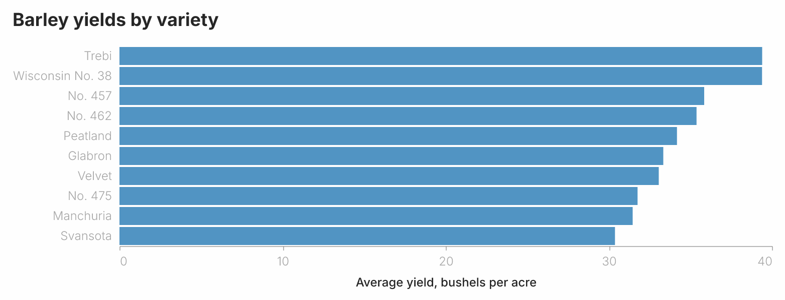
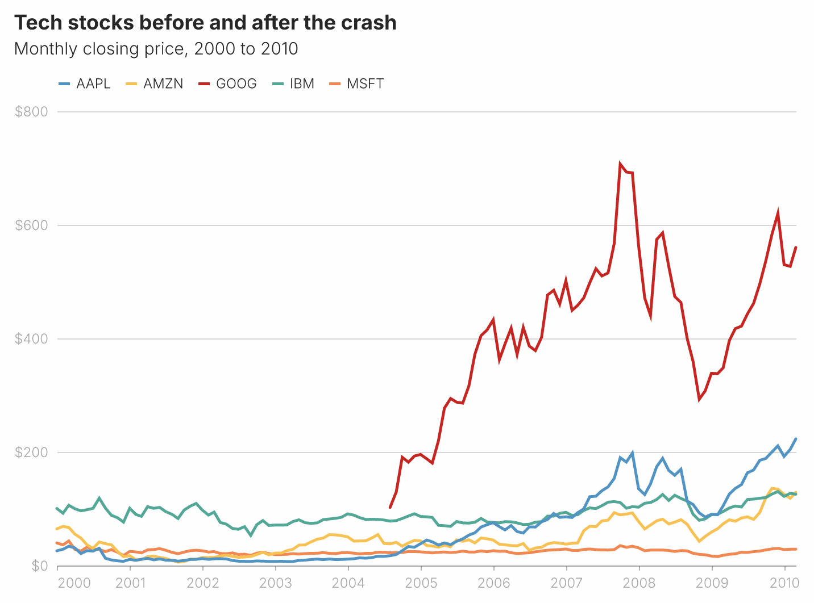
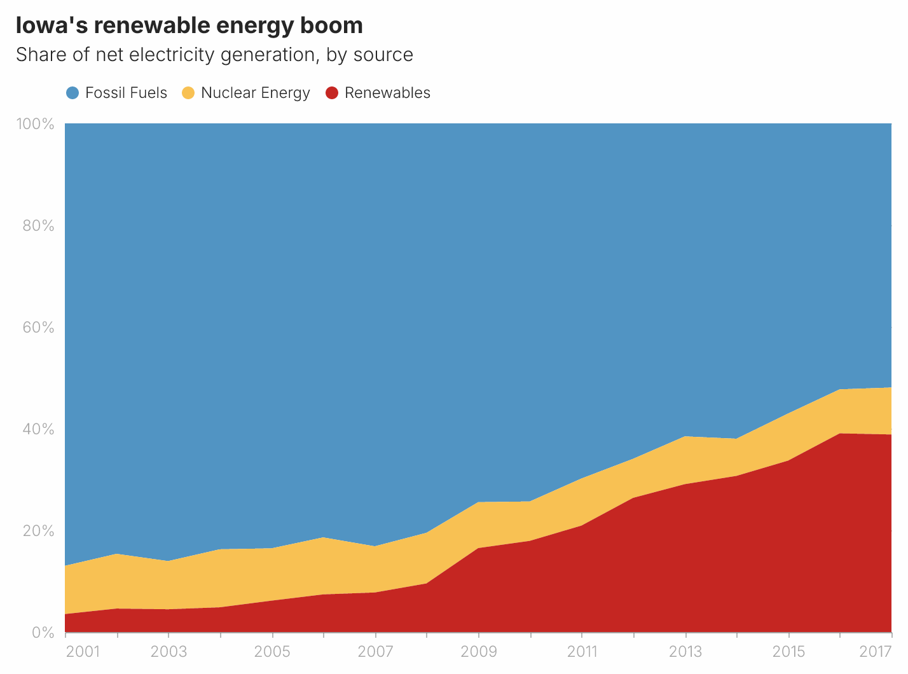
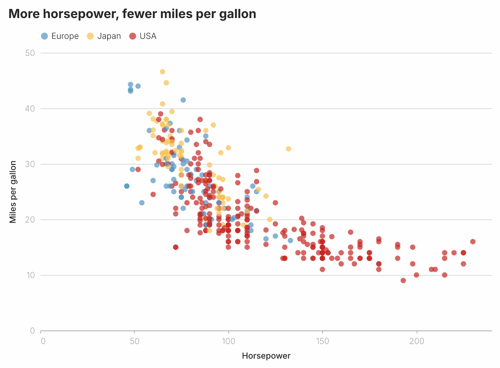
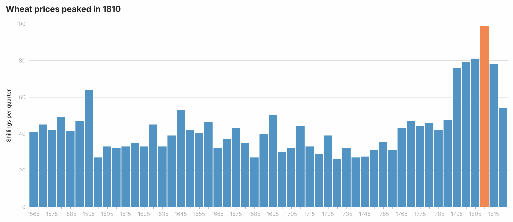
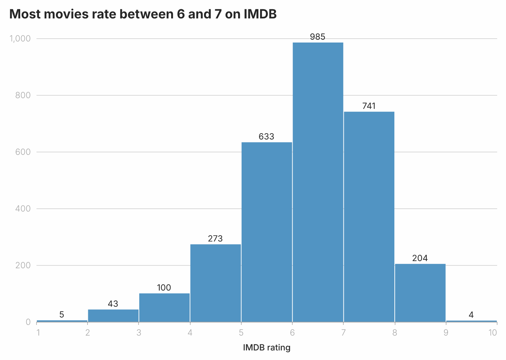
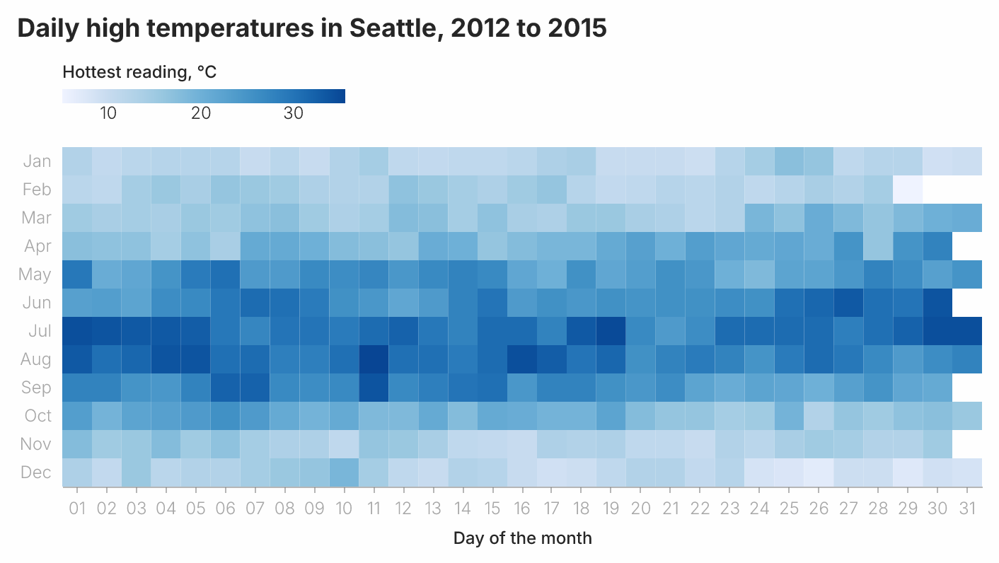
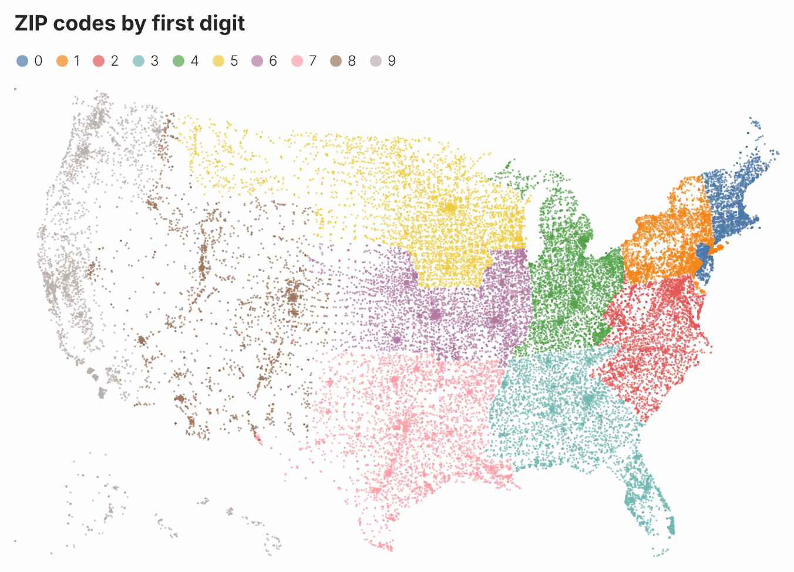

# Examples

Generated by [`gallery.py`](gallery.py). Every chart starts with:

```python
import altair as alt
from altair.datasets import data

import altair_stiles

alt.theme.enable("stiles")
```

## Bar chart



```python
source = data.barley()

(
    alt.Chart(source, title="Barley yields by variety")
    .mark_bar()
    .encode(
        x=alt.X("mean(yield):Q").title("Average yield, bushels per acre"),
        y=alt.Y("variety:N").sort("-x").title(None),
    )
)
```

## Line chart



```python
source = data.stocks()

(
    alt.Chart(
        source,
        title=alt.Title(
            "Tech stocks before and after the crash",
            subtitle="Monthly closing price, 2000 to 2010",
        ),
    )
    .mark_line()
    .encode(
        x=alt.X("date:T").title(None),
        y=alt.Y("price:Q").title(None).axis(format="$,.0f"),
        color=alt.Color("symbol:N").title(None),
    )
)
```

## Stacked area chart



```python
source = data.iowa_electricity()

(
    alt.Chart(
        source,
        title=alt.Title(
            "Iowa's renewable energy boom",
            subtitle="Share of net electricity generation, by source",
        ),
    )
    .mark_area()
    .encode(
        x=alt.X("year:T").title(None),
        y=alt.Y("net_generation:Q")
        .stack("normalize")
        .title(None)
        .axis(format=".0%"),
        color=alt.Color("source:N").title(None),
    )
)
```

## Scatter plot



```python
source = data.cars()

(
    alt.Chart(source, title="More horsepower, fewer miles per gallon")
    .mark_circle()
    .encode(
        x=alt.X("Horsepower:Q").title("Horsepower"),
        y=alt.Y("Miles_per_Gallon:Q").title("Miles per gallon"),
        color=alt.Color("Origin:N").title(None),
        tooltip=["Name", "Origin", "Horsepower", "Miles_per_Gallon"],
    )
)
```

## Highlighting one bar



```python
source = data.wheat()
is_peak = alt.datum.year == 1810

(
    alt.Chart(source, title="Wheat prices peaked in 1810")
    .mark_bar()
    .encode(
        x=alt.X("year:O").title(None).axis(labelOverlap=True),
        y=alt.Y("wheat:Q").title("Shillings per quarter"),
        color=alt.when(is_peak)
        .then(alt.value(altair_stiles.palette["accent"]))
        .otherwise(alt.value(altair_stiles.palette["default"])),
    )
)
```

## Histogram with labels



```python
source = data.movies()

base = alt.Chart(source, title="Most movies rate between 6 and 7 on IMDB").encode(
    x=alt.X("IMDB Rating:Q").bin().title("IMDB rating"),
    y=alt.Y("count():Q").title(None),
)
bars = base.mark_bar()
labels = base.mark_text(dy=-8).encode(text="count():Q")

bars + labels
```

## Heatmap



```python
source = data.seattle_weather()

(
    alt.Chart(source, title="Daily high temperatures in Seattle, 2012 to 2015")
    .mark_rect()
    .encode(
        x=alt.X("date(date):O").title("Day of the month"),
        y=alt.Y("month(date):O").title(None),
        color=alt.Color("max(temp_max):Q").title("Hottest reading, °C"),
    )
    .properties(width=650)
)
```

## Dot map



```python
source = data.zipcodes()

(
    alt.Chart(source, title="ZIP codes by first digit")
    # zip_code loads as a number, so 02139 arrives as 2139. Pad it back.
    .transform_calculate(
        digit="substring(pad(datum.zip_code, 5, '0', 'left'), 0, 1)"
    )
    .mark_circle(size=3)
    .encode(
        longitude="longitude:Q",
        latitude="latitude:Q",
        color=alt.Color("digit:N").title(None).scale(scheme="tableau10"),
    )
    .project("albersUsa")
)
```
